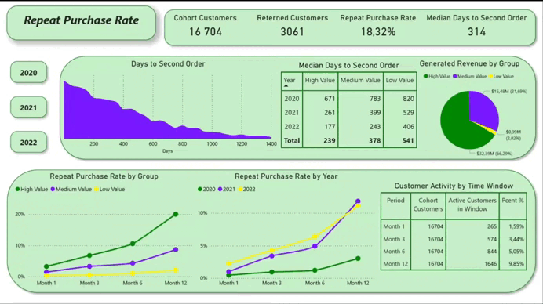

# Overview
This project analyses how often customers place a second order and how long it takes, by yearly cohort (2020–2022) and by customer value group.

## Key Findings
- The 12-month repeat purchase rate (RPR) rose from 5.44% (2020 cohort) to 19.84% (2021) and 21.88% (2022). Overall, 18.32% of 16,704 customers returned (3,061 customers).
- The high-value group (top 25% of customers by first-year revenue) has the highest rate: 42.08% in 2022 against 4.48% for the low-value group (see Limitations).
- Repeat orders are spread fairly evenly over the first year, about 1.6–1.7% of cohort customers per month in every window. About 82% of customers did not return within 12 months.

## Tools Used
- SQL 
- Python 
- Power BI

# Analysis

### 12-month repeat purchase rate by cohort and customer group

| Cohort | All | High value | Medium value | Low value |
|--------|-----|-----------|--------------|-----------|
| 2020 | 5.44% | 13.46% | 3.76% | 0.79% |
| 2021 | 19.84% | 39.02% | 18.06% | 4.20% |
| 2022 | 21.88% | 42.08% | 20.47% | 4.48% |

The window is the same for every cohort (12 months from the first order), so the rates are comparable across years. The reason for the jump from 2020 to 2021 cannot be seen in this data.

### Timing of repeat orders
Share of cohort customers (2020–2022) with a repeat order in each window after the first order:

| Window | Customers | Share | Share per month |
|--------|-----------|-------|-----------------|
| 0–1 month | 265 | 1.59% | 1.59% |
| 1–3 months | 574 | 3.44% | 1.72% |
| 3–6 months | 844 | 5.05% | 1.68% |
| 6–12 months | 1,646 | 9.85% | 1.64% |

Share = customers with a repeat order in the window ÷ 16,704 cohort customers. Share per month = share ÷ window length in months. A customer with orders in several windows is counted in each, so the windows add up to more than the 3,061 returning customers.

The 6–12 month window has the largest share only because it is the longest. Per month, the share is almost constant.
### Days between first and second order
Median days among customers who made a second order (orders up to 31 Dec 2023). Overall median: 314 days.

| Cohort | All | High value | Medium value | Low value |
|--------|-----|-----------|--------------|-----------|
| 2020 | 765 | 671 | 783 | 820 |
| 2021 | 373 | 261 | 399 | 529 |
| 2022 | 224 | 177 | 243 | 406 |

These medians are not comparable across cohorts (see Limitations).

### Recommendations
- Repeat orders do not concentrate in a particular month, so retention offers can be tested at several points in the first year rather than at one "critical window".
- Most customers (about 82%) do not return within 12 months, which is where the largest potential lies.
- Before concluding that retention improved, check why the 2020 cohort has such a low rate.

# Data

## Definitions
- Cohort = year of the customer's first order. Only customers acquired in 2020–2022 are included.
- RPR = share of cohort customers with a second order on a later date within 12 months of the first order.
- Customer groups: Low = bottom 25%, High = top 25%, Medium = the rest, by revenue in the 12 months after the first order, within each cohort year.
- Time to second order = days between the first and the second order date.

## Limitations
- Groups are defined by revenue in the first 12 months, which includes repeat purchases. A customer who returned is more likely to land in the high-value group, so the higher repeat rate of that group is partly built into the definition. The 25% of customers generating over 60% of revenue also follows from this definition. The group results describe the data and do not show that high-value customers are more loyal.
- Time to second order uses orders up to the end of 2023. Later cohorts have shorter observation windows, so their medians are lower by construction (765 → 224 days). Use the 12-month RPR to compare cohorts.
- The data show differences between cohorts but not their causes.

